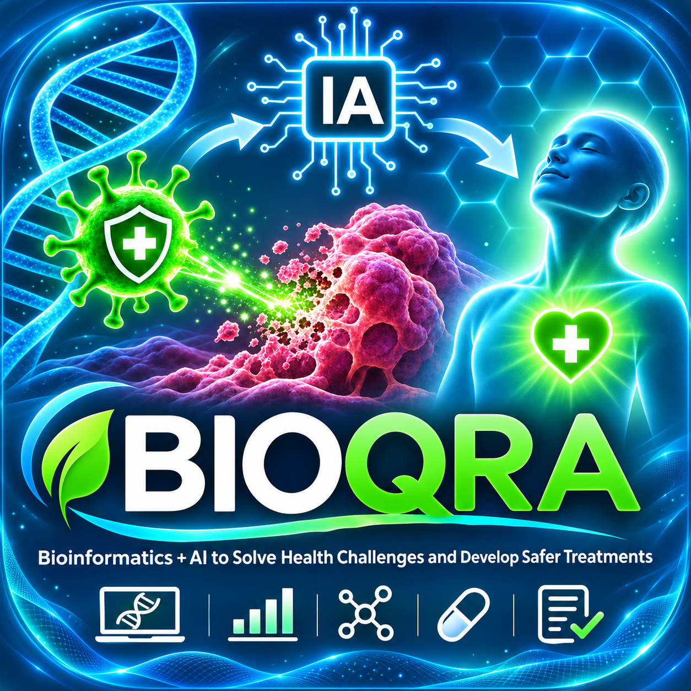

# BIOQRA — Open Bioinformatics Research & Patient Assistance



BIOQRA is an open-source project for Android and the web. It aims to help researchers discover bioinformatics challenges, develop reproducible computational approaches, and verify results with scientific software. A separate, privacy-first patient research module is planned to help people document their experiences, securely manage health records, and optionally contribute de-identified information to ethically reviewed research. BIOQRA is not a diagnostic, treatment, vaccine-testing, or medication-safety determination tool.

## Keep one-time ChatGPT login across APK upgrades

The ChatGPT session is encrypted and **is not** included in portable JSON backups. To retain the same Android app data on an APK upgrade, the new APK must use **the same package name and signing certificate** as the currently installed APK. The Android CI builds debug APKs on ephemeral GitHub runners; a fresh generated debug keystore is not guaranteed to match the previous one. Uninstalling an APK deletes its local ChatGPT login and saved results.

The GitHub Actions workflow accepts a private repository secret named `BIOQRA_DEBUG_KEYSTORE_B64`, containing a **base64-encoded stable Android debug keystore**. The keystore must use the standard debug alias `androiddebugkey` and passwords `android` and remain private. Configure this once under GitHub repository Settings → Secrets and variables → Actions, and use the same signing keystore for subsequent builds. The workflow warns if it is not configured. **Changing to a new stable key for the first time will not upgrade an APK signed with another key**; for that first transition, export the portable settings and saved results before uninstalling, reinstall, and log in once. Afterwards, upgrades with the same key will preserve the encrypted local login. Do not commit keystores or passwords to the public repository.

Portable settings import does not restore ChatGPT credentials or previously granted AI consent; these must be authorized locally. The OAuth flow can skip repeated logins only while the provider's tokens remain valid/refreshable and the app data is intact. Never bypass required account consent.

## One-click full backup and restore (ZIP)

**AI Settings → Backup, Restore & PDF → Export all / Import all** now offers a single portable ZIP containing `settings.json`, `results.json` and `pdf/<challenge>/<YYMMDD-challenge.pdf>`. Existing dated PDF files from the chosen folder are included (up to the bounded archive limits); for a stored latest AI result without an existing PDF, BIOQRA generates its PDF while exporting. The ZIP can be saved locally, on removable storage or in any storage provider exposed by Android's document picker.

**Import all** restores the global and per-challenge model settings, the saved/latest AI result per challenge and the PDF files into the configured destination's per-challenge folders. Before restoring a ZIP containing PDFs, select **Choose folder for automatic PDFs** in AI Settings. Existing PDF documents with the same filename are **not overwritten**, and newer local AI results take precedence. Backups are validated with file-type, size, item-count and path checks; archive limits are 50 MB total and approximately 550 entries. Large research collections beyond those limits require individual exports or a later archival implementation.

**Privacy:** Never includes ChatGPT OAuth/access/refresh tokens, passwords, file access grants or consent for unattended AI use. Automatic consent is switched off when importing settings. The ZIP does contain the text of saved AI analyses and any accessible exported PDFs, so store it securely and do not put confidential clinical/patient data into BIOQRA. Only the current/latest saved analysis per challenge is tracked in JSON; the archive may retain older dated PDF exports when present.

**Automatic Mode login guidance:** If ChatGPT is disconnected, the dialog offers to open **AI Settings → ChatGPT account → ChatGPT login** instead of referring to a removed home-screen login button.

## Backup, restoration, and automatic PDF exports

In **AI Settings → Backup, Restore & PDF**, BIOQRA uses Android's built-in file picker (Storage Access Framework) to:

- **Export settings (.json)** and **Import settings (.json)**. The portable backup includes the global AI model choice, per-challenge model preferences, and the local daily AI request limit. It **never** contains OAuth credentials, secrets, login sessions, file-system permissions or consent for unattended AI use. After importing, automatic consent must be enabled again, and the PDF destination folder must be reselected on the new device.
- **Export saved AI results (.json)** and **Import saved AI results (.json)**. These contain the most recent persisted proposal per challenge, its title, date, public source URL and model if available. Imported results reappear when the relevant challenge is opened. Exported JSON may contain sensitive text if someone previously pasted it into a manually authorized prompt: treat backups as private files and only use public/non-patient data.
- **Choose folder for automatic PDFs**. This opens Android's folder picker and retains the folder's permission on the device. Each newly generated saved draft is automatically exported as a readable PDF, with title, source and date. Choose **Export all saved results as PDFs** to export older restored results too. An individual challenge also has **Save this challenge result as PDF**.

Each challenge now has **one single project folder**, containing dated PDF files named `YYMMDD-Challenge.pdf`, for example `Gastroesophageal transformation into cancer/261117-Gastroesophageal transformation into cancer.pdf` under the configured root folder. The date comes from the saved analysis, not the export date. Files are sanitized for Android. Re-exporting the same day's draft reuses its existing PDF if supported by the storage provider; a later day creates another file in the same challenge folder.

The JSON formats are versioned as `bioqra-settings` and `bioqra-results`. Results remain AI drafts, not verified experimental results. No external storage service, paid PDF tool, backup account or clinical data upload is required. For full restoration of settings **and** results, export and import both JSON files separately. Settings include no PDF folder permissions; Android requires choosing a destination again.

## AI model preferences and low-interaction Automatic Mode

**AI Settings** on the main screen manages the authenticated account's model list. Every challenge card has its own **AI model** dropdown. Each challenge initially inherits the global model; selecting a model there saves an override locally. Selecting **Apply this model to ALL challenges** from AI Settings replaces all saved overrides and applies the selected global default to existing and future challenge cards. Choices survive app restart on the same device.

The default **Auto · preferred high-capability model** selects among models *actually returned by the connected account*, using transparent model-name hints (prioritizing known full/Pro/high variants over mini/nano); this is **not a guaranteed capability ranking** and model availability or limits can change. If a specifically saved model is unavailable, the attempt stops with a message rather than silently substituting another model.

**Automatic Mode, with optional once-only consent:** When the user explicitly enables **Automatically analyze selected public challenges** in AI Settings, opening an individual challenge automatically resolves its public details and uses the saved model without repeated model or consent dialogs. The setting is **off by default**; users can disable it at any time. No private user-pasted input is transmitted in unattended mode; only retrieved public organizer text. The application imposes a **local limit of 3 attempts/day by default**, configurable to 1, 3, 5 or 10 attempts, and avoids automatic repeat attempts on the same challenge during the same local day. Failed attempts may count toward the limit. AI drafts can be re-opened from local app preferences; no third-party result submission is performed. The manual AI button can still request a single attempt with a separate confirmation.

This is **user-triggered per-selected-challenge automation**, not a background agent processing every listing without the app open. Daily limits are local safeguards, not a guarantee of available ChatGPT plan capacity or a financial quota. No model or plan promises unlimited free usage. The AI's analysis is **unverified** until independent tools and suitable real data have been used.

## Automatic discovery of the detailed challenge brief

BIOQRA no longer assumes that a catalog URL is the actual problem statement. In **Automatic Mode**, when a challenge is selected, its public HTTPS page is inspected and BIOQRA searches for relevant, challenge-title-matching links **on the same approved organizer site**. It evaluates at most four follow-up pages (from up to eight potential links), extracts the public statement and shows the exact selected source URL. No ChatGPT capacity is consumed during link discovery, which relies on local HTML parsing and ranking.

If the detailed brief is confidently identified, BIOQRA displays it and requests consent before sharing the public text with ChatGPT. If links are missing, the page needs JavaScript/login, or the result is ambiguous, BIOQRA **does not claim the correct brief was found** and does not launch AI automatically. The official original link remains accessible. Link discovery does not bypass authentication, execute scripts, follow external redirects, upload data, submit applications or download private datasets.

Source links and announcements change; this is a first controlled site-specific resolver, not a universal web-crawling agent. Other source-site adapters and robust evaluation against real challenge pages remain future work. HTTPS and a domain allowlist reduce risk but do not guarantee safe content or scientifically valid rules. Never enter private patient data in the public research workbench.

## Mode labels and interpretation of cancer research AI drafts

Android home-screen buttons are named **Manual Mode** and **Automatic Mode**. Selecting a challenge carries its kind (educational exercise, benchmark, funding call, etc.) into the workbench. For research funding calls such as **Gastroesophageal transformation into cancer**, BIOQRA now labels the output **AI RESEARCH PROPOSAL — UNVERIFIED** and explains that research data, experimental testing, eligible teams and independent validation are missing. It must not call the funding call a solved programming problem or a verified cancer treatment.

The project owner's example AI draft is a **proposal**, not a validated result: it suggests a longitudinal dataset, a site-held-out machine-learning baseline and specific tests, but no real dataset was provided and no code was executed. Scientific outcomes require research governance and validation.

## Interactive challenge workspace: Manual and Automatic (experimental)

Choose **Manual Mode** or **Automatic Mode** on the BIOQRA Android home screen, then tap a challenge result to open its workbench instead of going directly to the external website. Both modes provide a separate button to open the organizer's official page in the browser.

- **Manual** (default): retrieve publicly readable HTML from an allowlisted HTTPS research site and inspect it. Paste *public* DNA/RNA sample sequences and use the local/offline sequence calculator for nucleotide counts, GC%, RNA transcription, and reverse complement. No ChatGPT request is sent.
- **Automatic**: requires an authorized ChatGPT account. BIOQRA first retrieves only public HTML from approved HTTPS research domains; it does not log in to challenge websites, bypass paywalls, follow redirects, execute downloaded code, retrieve private data, or upload files. After showing the retrieved text, it requests explicit confirmation before transmitting the public statement and any user-pasted public example to ChatGPT and choosing a model. The model is asked for a **reproducible draft** and suggested checks, not to claim scientific or clinical validation.

**Limitations:** A source URL or HTTPS certificate is not sufficient to prove its contents safe or scientifically valid. Some challenges are JS-rendered, multi-page, private, dataset-based, require registration, have explicit AI restrictions or prohibit automated assistance; BIOQRA cannot currently solve those automatically. Local sequence checks are narrow educational helpers, not general solution validators. AI-generated Python is displayed as text and is **not executed** in the Android app. BIOQRA does not submit solutions, modify external accounts, run third-party online tools automatically, or assert that a challenge is solved. AI use is subject to the connected plan's limits and permissions. Do not paste patient records, private datasets, credentials, protected research data, or other sensitive material.

The trusted source reader is implemented in `TrustedChallengeReader.java` and the workbench in `ChallengeActivity.java`. The offline calculator is `LocalBioinformatics.java`. All operations are user-initiated and limited to a single selected challenge; continuous autonomous execution is not part of this milestone. Real device testing of the full login → model selection → draft response path is still required.

## ChatGPT account sign-in (experimental)

The Android **AI Settings · models & automation** screen has a **ChatGPT login** button, account status, reconnect and local sign-out controls. After the first successful login, BIOQRA keeps the encrypted access and refresh tokens in Android Keystore-protected local storage and automatically refreshes expiring access tokens when ChatGPT permits. Reopening the app does not require login again. Revocation, expired refresh credentials, switching accounts, or clearing/uninstalling app data can require reauthentication; the provider's mandatory approval screens cannot be bypassed. The login button is no longer shown in the home-screen header. It opens an account dialog and then an official browser-based OAuth/PKCE consent flow for eligible ChatGPT plans, without accepting or storing the user's ChatGPT password. Once connected, the account button inside AI Settings displays **ChatGPT ✓** and offers account status, reauthorization and local sign-out. Authorization is separate from challenge participation.

The current release includes the login UI, Manual and Automatic workbench views, and an experimental ChatGPT draft-generation path. Automatic mode still requires per-attempt consent, and does **not** independently execute or validate AI-produced solutions. Plan-linked access is subject to availability, explicit authorization and usage limits. Real-world OAuth success must still be verified on a test device; a successful APK build alone is not proof that an account can connect.

BIOQRA must not send private medical data, submit solutions to competitions, or incur AI usage without explicit user authorization. It does not support entering a ChatGPT password or scraping a browser session.

## Android APK: download, install, and use

**Development status: an experimental Android source build is now configured.** Debug APKs are produced by GitHub Actions when the build succeeds; there is not yet a reviewed official GitHub Release. Check [Android Debug APK Actions](https://github.com/blas-llavero/bioqra/actions/workflows/android.yml).

To install the current experimental build on Android **if GitHub Actions shows a successful build**:

1. Open [Android Debug APK Actions](https://github.com/blas-llavero/bioqra/actions/workflows/android.yml) in your Android browser while signed into GitHub.
2. Open the latest **successful** run of **Android Debug APK**.
3. At the bottom under **Artifacts**, download **bioqra-debug-apk** (a ZIP archive). Extract the ZIP with Android's Files app.
4. Locate **app-debug.apk** in the extracted files. Open it. If prompted, allow installation from that source for this operation; revoke the permission afterward.
5. Launch **BIOQRA**. The home screen places **Cancer Research** top left and **Refresh** top right. **Challenges** now includes a source selector for Rosalind, Open Problems, Cancer Grand Challenges, DREAM, hackathons and ML Contests. **Hackathons** and **Cancer Research** contain curated, sourced listings with clear participation labels; they are not automatically certified as open competitions. **Help** explains the pilot. **App Description** opens an in-app video player for the approved English introduction. The approved English MP4 is now bundled with the APK and automatically plays within the centered video player; no file selection is required. **How to Use** still shows a placeholder until its separate tutorial is reviewed.
6. On launch the app attempts to update the five official Rosalind tracks and checks the Open Problems benchmark index. If Open Problems cannot be verified, a reviewed directory remains visible; Rosalind retains its own local cache or a six-item starter list. No medical or patient records are collected.

The debug APK is unsigned for store distribution and signed with a development key by Android tooling; it is only for testing and is not a vetted production release. The approved English introduction is bundled into the GitHub build, and the workflow verifies its presence inside the assembled APK. The How to Use tutorial has not yet been approved. Do not download APKs from unofficial mirrors.

## Author and purpose

**Conceived and programmed by Blas Llavero.** More information: https://blasllavero.com

BIOQRA is intended as open-source software that everyone can study, modify, and use for lawful, charitable and public-benefit purposes, subject to the project's eventual license and applicable medical-data protections. The project aims to support equitable access to scientific knowledge, health research and technology across countries. It does not promise cures, clinical benefits, or access to particular vaccines or medicines.

## Planned capabilities

- Find bioinformatics challenges from established public research and educational platforms.
- Run transparent, reproducible analysis pipelines using open-source tools; distinguish computational validation from experimental or clinical validation.
- Prioritize local and self-hosted processing to minimize use of paid AI services.
- Provide an Android interface and web application.
- Support ten interface languages, including English, Catalan and Spanish, selected from device language where supported.
- Respect Android gesture/navigation bars and system insets.
- Provide accessible descriptions, screen-reader support, and optional natural-sounding open-source narration.
- Include **About** and **Help** videos, each up to 30 seconds per supported language, **only after the project owner has reviewed and approved every image, video and audio asset**.
- Develop the patient module with explicit informed consent, granular sharing controls, data minimization, encryption, deletion/export options, access controls and appropriate GDPR compliance.
- Avoid interpreting patient anecdotes as proof of causation, treatment efficacy or vaccine safety. Encourage formal reporting of suspected adverse reactions to healthcare professionals and competent pharmacovigilance authorities.

**Media approval rule:** Do not commit or upload images, video or audio files to this repository until Blas Llavero has explicitly reviewed and approved them.

## Approved introductory video (English)

The English 30-second Piper-narrated introduction has been reviewed and approved by the project owner. The Android player code is implemented in `VideoActivity.java`; the actual MP4 must be placed in:

`app/src/main/res/raw/bioqra_app_description_en.mp4`

Android packaging uses the resource name without the file extension (`R.raw.bioqra_app_description_en`). Use exactly that filename (lowercase letters and underscores) and create the `raw` directory if necessary. **The owner-approved MP4 is committed to this repository** and is packaged into the APK for offline playback. GitHub Actions verifies its presence in the APK. The standalone file picker and redundant narration caption have been removed from the playback screen; video is centered while retaining the source aspect ratio. The distinct `How to Use` video will use real screenshots after that tutorial has been approved.

## Live discovery across official biomedical challenge pages

BIOQRA 0.3 adds **Grand Challenge index discovery** on app startup and when the user presses **Refresh**. It scans each page of the official [medical-image analysis challenge index](https://grand-challenge.org/challenges/), not only a short manually written list. The index contains hundreds of historical challenges, but BIOQRA only treats a listing as open/upcoming if the index explicitly states **Accepting submissions** or **Opening submissions**, and rejects known expired deadlines. It keeps an offline cache after a successful scan. The scan may fail if the site's HTML changes, access is blocked or the network is unavailable; in this case the previous entries remain and their verification dates expire rather than silently claiming availability.

**Scope and limitations:** Neither the internet nor Grand Challenge offers a universal registry of every bioinformatics competition worldwide. This iteration significantly broadens discovery through Grand Challenge and keeps the Rosalind and Open Problems integrations, but it does **not** guarantee worldwide exhaustive coverage, automatically verify eligibility, or guarantee that the submission page remains open. Some events allow ongoing post-challenge algorithm submissions rather than new competition entries; always confirm with the organizer. Further official-platform adapters (DREAM, CodaBench and other registries) are planned. No ChatGPT API, AI credits or patient information is required for this public index scan.

## Bundling the approved App Description video

The owner-approved **30-second English Piper video** is already committed as `app/src/main/res/raw/bioqra_app_description_en.mp4`. The in-app player automatically plays this bundled resource offline when **App Description** is tapped. It is centered on the screen at the original aspect ratio, with no redundant narration caption or local file picker.

## Competition status and complete pagination (November 2026)

The **Challenges** screen now defaults to **Open / Upcoming** and prioritizes competitions or funding calls with a concrete research task. Use the separate **source** and **availability** selectors to switch between:

- **Open / Upcoming**: verified research competitions and upcoming submission phases. Each status is based on an official source review dated 16 November 2026. Seven days after that date, records without an authoritative live status check are automatically downgraded to **Needs verification** rather than falsely marked open.
- **Research benchmarks**: Open Problems benchmarks for reproducible research, not time-limited contests.
- **Educational exercises**: Rosalind exercises.
- **Needs verification**: directories, uncertain or stale opportunities.
- **All records**: every entry, including funded research, historical events and restricted competitions. These entries are clearly labeled and are **not** presented as open.

Use **Previous** and **Next** below the list. The interface displays 25 records per page, with a correct result count and page number; there is no 100-result truncation. Searches and source/filter changes reset to page one.

Examples of actual research competitions include OWL (prostate cancer recurrence explanation), Light My Cells 2 (fluorescence microscopy prediction), COBRA (radiotherapy CT reconstruction; validation begins 1 December 2026), and TopBrain V2 (brain vessel segmentation; final-test phase opens 11 December 2026). Lung Nodule Volumetry is restricted to vendors with CE-certified products and is **not** included in the general open-competition view. Grand Challenge organizers must be consulted for eligibility and submission rules.

**Important:** As of this milestone, live automatic refresh covers Rosalind and checks the Open Problems index; the other competitions use a dated official-source review and conservative staleness logic, not an automated live registration check. The application cannot guarantee a place remains open after the review date.

## Multi-source challenge directory (Android prototype)

The Android challenge source filter now includes:

- **Rosalind:** 284 educational exercises, automatically refreshed from five official tracks.
- **Open Problems:** 14 single-cell computational benchmarks. BIOQRA checks the official index on opening the app, falling back to the reviewed directory if the page format changes or connectivity fails. These benchmarks have scientific evaluation metrics; a benchmark is not a treatment.
- **Cancer Grand Challenges:** research topics and selected funding calls, including gastroesophageal cancer prevention research. The **24 November 2026** application deadline is displayed with a status derived from the device date; submissions are intended for eligible international research teams, not necessarily individuals.
- **DREAM:** a link to official open biomedical competitions; each challenge's eligibility and dates must be checked with the organizer.
- **Hackathons:** organizer pages for BioHackathon Europe and GENEDIS. Directory listings may refer to concluded events; do not assume registration is open.
- **ML Contests:** a competition aggregator. BIOQRA has not individually verified its third-party listings.

This is a curated public research directory, not an autonomous across-the-web crawler. The Open Problems source is checked dynamically; the other non-Rosalind sources still require periodic editorial review. The built-in list stores no patient information. Scientific solutions and their validation remain future milestones.

## First functionality: offline challenge catalog

The initial catalog contains 12 selected Rosalind exercises and 14 Open Problems benchmarks. It can be searched offline without AI calls or paid APIs. See [catalog instructions](docs/CHALLENGE_CATALOG.md). No challenge has been solved or validated by BIOQRA yet.

## Challenge catalog refresh (experimental)

BIOQRA includes a Python refresh utility for the five official Rosalind problem tracks. The original one-track downloader retrieved only part of the public catalog; the revised synchronizer fetches and merges all five sections. It downloads public problem titles and URLs from one trusted source, validates a minimum count, and replaces the local JSON cache atomically; on a failed refresh the previously saved cache is preserved. It uses no ChatGPT API and does not send patient data. Other sources (hackathons, DREAM, Open Problems, oncology) are not yet synchronized automatically. **The Android app is buildable and attempts Rosalind and Open Problems refresh on launch; other competition sources still require a dedicated live-status synchronizer.**

Run after cloning:

```bash
python tools/refresh_challenges.py
python tools/list_challenges.py --live
python tools/list_challenges.py --live --search cancer
python -m unittest discover -s tests -v
```

The refresh command requires Internet access, while the resulting JSON can be read offline using --live. The catalog count is not guaranteed to equal the website's displayed total if the site changes. A refresh is rejected if any track is empty or fewer than 200 unique problems are gathered. An initial cache is created only after a successful fetch.

## Current status

Project setup / requirements definition. The Android prototype and limited challenge index integration are implemented and buildable. The full website, automatic competition status sync, scientific solver, and patient module are not yet implemented.

## Build from source

The native Android prototype uses Java 17, Android Gradle Plugin 8.9.2, SDK 35 and Gradle 8.11.1. Build it with a compatible Android SDK and Gradle installation:

```bash
gradle :app:assembleDebug
```

Expected debug APK output (after a successful build): `app/build/outputs/apk/debug/app-debug.apk`.

The Python catalog utility can also be run from a local clone (requires Python 3.10+):

```bash
git clone https://github.com/blas-llavero/bioqra.git
cd bioqra
python tools/list_challenges.py
python tools/list_challenges.py --source Rosalind
python tools/list_challenges.py --search DNA
python -m unittest discover -s tests -v
```

These Python catalog commands are offline after cloning and use only the Python standard library. The refresh script requires Internet access. The website, clinical patient module, scientific solving engine, localized UI, reviewed logo and videos remain future milestones.
